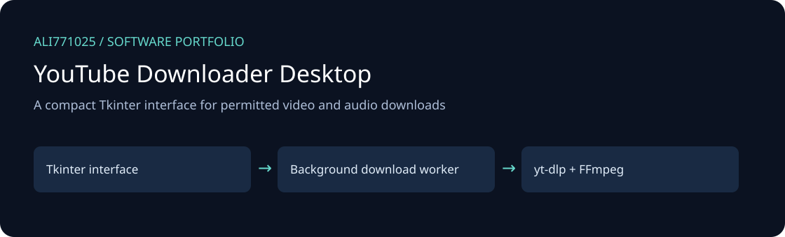
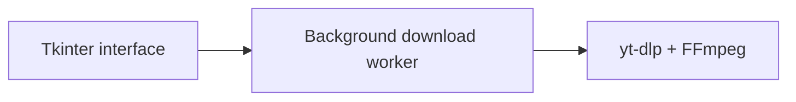

# YouTube Downloader Desktop

<!-- project-contact:start -->
**Work with Yosof Omrani:** [Email a project inquiry](mailto:aliomrani916@gmail.com) · **aliomrani916@gmail.com** · [Services & contact](https://ali771025.github.io/software-portfolio/en/contact/) · [Portfolio walkthrough](https://ali771025.github.io/software-portfolio/en/#projects)
<!-- project-contact:end -->

A compact Tkinter interface for permitted video and audio downloads

[راهنمای فارسی](docs/README.fa.md) · [Discuss a project](https://github.com/Ali771025)

## What this project demonstrates

- Video-quality selection and audio-only MP3 download option.
- Background download worker, progress feedback and destination selection.
- URL validation and user-facing error handling.

**Technology:** Python, Tkinter, yt-dlp, FFmpeg.

## Architecture

The illustration describes source boundaries; it is not a product screenshot.

## Explore and set up

Install Python with Tkinter, restore `requirements.txt`, install FFmpeg separately and make it available on PATH. Start with `python youtube_downloader_ui.py`. Network access and current yt-dlp platform support are external requirements.

## Portfolio scope and limitations

Download only media you own or are authorized to download, subject to platform terms. This application does not establish permission to download third-party media. Virtual environments and media files are excluded. No real downloads or runtime tests were performed for publication.

This edition contains selected source only. Private data, customer documents, databases, deployment secrets, old Git history, generated outputs, dependency caches and model weights are excluded. No new tests, builds, or live integrations were executed for this publication; runtime behavior and production readiness are not newly validated.

## Work with me

Need a similar workflow, an integration, or modernization of an existing application? [Contact Ali on GitHub](https://github.com/Ali771025) with your business process, target platform and delivery constraints. This source demonstrates relevant implementation areas; any proposed delivery needs its own agreed scope and acceptance criteria.

## Dependencies and attribution

Existing source headers and bundled notices remain applicable. Third-party components retain their own licenses; restore dependencies from the manifests. No additional license grant is implied by this portfolio publication.
